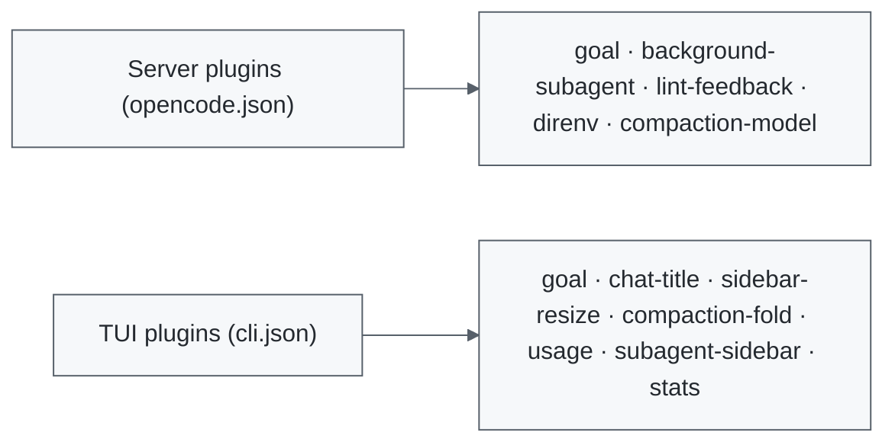

<a id="readme-top"></a>

<div align="center">

# OpenCode Plugins

**Eleven maintained plugins for OpenCode V2.**

Persistent goals, chat usage, terminal customization, background subagents, lint feedback, direnv, and compaction, each in its own package.

[](https://github.com/madsoftwaredev/opencode-plugins/actions/workflows/ci.yml)
[](https://www.npmjs.com/package/@madsoftwaredev/opencode-background-subagent)
[](LICENSE)

[Plugins](#plugins) &nbsp;•&nbsp; [Install](#install) &nbsp;•&nbsp; [Develop](#develop)

</div>

> [!NOTE]
> Built and maintained by [MAD Software](https://github.com/madsoftwaredev).

## How It Works

OpenCode V2 loads plugins from two places. Server plugins extend sessions, tools, and shell behavior through `opencode.json`. TUI plugins extend the terminal interface through `cli.json`. Each package is independent, so install only what you want.



## Plugins

| Plugin | Surface | What It Does |
| --- | --- | --- |
| [Background subagent](packages/background-subagent/README.md) · [npm](https://www.npmjs.com/package/@madsoftwaredev/opencode-background-subagent) | Server | Runs subagents in the background by default; explicit foreground calls still wait. |
| [Subagent sidebar](packages/subagent-sidebar/README.md) · [npm](https://www.npmjs.com/package/@madsoftwaredev/opencode-subagent-sidebar) | TUI | Shows live child and nested subagent sessions; click a row to open it. |
| [Stats](packages/stats/README.md) · [npm](https://www.npmjs.com/package/@madsoftwaredev/opencode-stats) | TUI | Shows token speed and session-wide turn and step counts in the prompt footer; toggle each in the TUI. |
| [Lint feedback](packages/lint-feedback/README.md) · [npm](https://www.npmjs.com/package/@madsoftwaredev/opencode-lint-feedback) | Server | Appends project-local ESLint diagnostics after successful edits. Checks only, never fixes. |
| [direnv](packages/direnv/README.md) · [npm](https://www.npmjs.com/package/@madsoftwaredev/opencode-direnv) | Server | Applies the approved direnv environment to each shell command's working directory. |
| [Compaction model](packages/compaction-model/README.md) · [npm](https://www.npmjs.com/package/@madsoftwaredev/opencode-compaction-model) | Server | Summarizes checkpoints with a selectable model and reasoning variant. |
| [Compaction fold](packages/compaction-fold/README.md) · [npm](https://www.npmjs.com/package/@madsoftwaredev/opencode-compaction-fold) | TUI | Folds only generated compaction summaries into clickable rows; configurable default open or closed. |
| [Goal](packages/goal/README.md) · [npm](https://www.npmjs.com/package/@madsoftwaredev/opencode-goal) | Server + TUI | Keeps a persistent goal across compaction, resumes work within a nudge budget, and shows goal state above the composer. |
| [Chat title](packages/chat-title/README.md) · [npm](https://www.npmjs.com/package/@madsoftwaredev/opencode-chat-title) | TUI | Keeps the current chat title visible above the transcript while the sidebar is hidden. |
| [Sidebar resize](packages/sidebar-resize/README.md) · [npm](https://www.npmjs.com/package/@madsoftwaredev/opencode-sidebar-resize) | TUI | Adds a draggable sidebar edge and saves the chosen width. |
| [Usage](packages/usage/README.md) · [npm](https://www.npmjs.com/package/@madsoftwaredev/opencode-usage) | TUI | Shows chat and subagent tokens, cache efficiency, recorded cost, and API-equivalent cost in the sidebar and `/usage` popup. |

Each plugin README documents its behavior, setup, and limitations.

### Deprecated

[`@madsoftwaredev/opencode-btw`](packages/btw/README.md) (`/btw`) is deprecated
and no longer maintained. Remove it from your OpenCode plugins configuration.
Its source remains available for reference.

> [!WARNING]
> Upgrading from `0.1.0`? Background subagent, subagent sidebar, lint feedback, and direnv dropped the `local.` prefix from their plugin IDs in `0.1.1`. npm package names are unchanged, but update any config rules that reference the old IDs (`local.direnv` is now `direnv`, and so on).

## What This Looks Like

### Session Stats in the Footer

```text
44.4 tok/s · 3 turns · 8 steps
```

The `stats` plugin appends live token speed and session-wide turn and step counts to the prompt footer. Enable or disable each stat in `cli.json`, or save overrides with `/stats`.

### Background Subagents by Default

<table>
<tr>
<th align="left">Without the plugin</th>
<th align="left">With the plugin</th>
</tr>
<tr>
<td valign="top">

> A `subagent` call that omits `background` blocks the parent until the child finishes.

<em>Every delegated task pauses the parent turn.</em>

</td>
<td valign="top">

> The same call runs in the background, and the child reports back later.

<em>Explicit `background: false` still waits when the next step needs the result.</em>

</td>
</tr>
</table>

## Install

Requires OpenCode V2. Install each package you want with `opencode plugin add`:

```sh
# Server plugins (opencode.json)
opencode plugin add @madsoftwaredev/opencode-background-subagent
opencode plugin add @madsoftwaredev/opencode-lint-feedback
opencode plugin add @madsoftwaredev/opencode-direnv
opencode plugin add @madsoftwaredev/opencode-compaction-model

# TUI plugins (cli.json)
opencode plugin add @madsoftwaredev/opencode-subagent-sidebar
opencode plugin add @madsoftwaredev/opencode-stats
opencode plugin add @madsoftwaredev/opencode-chat-title
opencode plugin add @madsoftwaredev/opencode-sidebar-resize
opencode plugin add @madsoftwaredev/opencode-compaction-fold
opencode plugin add @madsoftwaredev/opencode-usage

# Server + TUI
opencode plugin add @madsoftwaredev/opencode-goal
```

Restart the OpenCode TUI after installing a TUI plugin.

Stats and usage are separate: stats adds speed, turns, and steps to the footer;
usage adds token and cost accounting to the sidebar and `/usage` popup. Install
either or both. Goal needs its server plugin running for its TUI to show state.

Each package has its own version line, so `opencode plugin update` moves only the
packages that changed.

<details>
<summary><b>Managing installed packages</b></summary>

```sh
opencode plugin list
opencode plugin check
opencode plugin update
```

The CLI checks and updates installed packages; exact version pins remain pinned.

</details>

## Configure Compaction

The compaction plugin defaults to
`opencode-go/deepseek-v4.1-flash#max`. To use a different connected model, set
`options.model` in its entry in `opencode.json`. Replace the package's string
entry with the object form below, preserving your other plugins:

```jsonc
{
  "$schema": "https://opencode.ai/config.json",
  "plugins": [
    {
      "package": "@madsoftwaredev/opencode-compaction-model",
      "options": {
        "model": "provider/model#variant"
      }
    }
  ]
}
```

Use `provider/model` from a connected provider; `#variant` is optional. On
failure, the plugin logs a diagnostic and lets OpenCode use its normal session
model for compaction. See the [full compaction guide](packages/compaction-model/README.md)
for details and a working configuration example.

## Requirements

| Plugin | Requires |
| --- | --- |
| direnv | `direnv` installed where the OpenCode server runs, plus an approved `.envrc` per project (`direnv allow`). |
| Lint feedback | Node on the shell's `PATH`, project-installed ESLint 9 or 10, and a flat `eslint.config.*` file. |
| Subagent sidebar, stats, chat title, sidebar resize, compaction fold, usage | The OpenCode terminal UI. |
| Goal, usage | OpenCode V2 with the 2.0.27 plugin API and OpenTUI 0.5.17 or later. Goal also requires its server plugin. |
| Sidebar resize, chat title | OpenCode 2.1.0 and OpenTUI 0.6.6 or later; use internal layout adapters. |
| Compaction fold | OpenCode 2.1.0 and OpenTUI 0.6.6 or later; uses an internal transcript-layout adapter. See its [compatibility notes](packages/compaction-fold/README.md#compatibility-and-safety). |

## Develop

Development and tests require Bun, Node.js 22+, and `direnv`:

```sh
git clone https://github.com/madsoftwaredev/opencode-plugins.git
cd opencode-plugins
bun install --frozen-lockfile
bun run check
```

`bun run check` runs the entrypoint build check and all package and release-script tests.
The test command runs each package in a separate process so its OpenTUI version owns
its native runtime, and preloads the Solid JSX transform for rendered TUI tests. Tests use
temporary projects and do not require a live OpenCode server.

To try a package directly from the latest source before a release:

```sh
opencode plugin add 'github:madsoftwaredev/opencode-plugins#main::path:packages/direnv'
```

Replace `direnv` with the package directory you want to try.

Issues and ideas are welcome in the [GitHub issue tracker](https://github.com/madsoftwaredev/opencode-plugins/issues).

<details>
<summary><b>Maintainers: Publishing Releases</b></summary>

Each package versions and releases on its own. Decide the bump per package,
then update only the manifests you changed and refresh the lockfile:

```sh
bun install
bun run check
```

For a package's **first** npm release, sign in with `npm login` and publish that
package once locally, for example:

```sh
bun scripts/publish.ts packages/goal --expected-version 0.1.0
```

Then configure that new package's Trusted Publisher to use `release.yml`, as
described below. Existing packages' Trusted Publisher settings do not change.
Subsequent releases use the tag-triggered workflow.

Preview what a tag would publish before pushing it (the planned version must
already be in the manifest):

```sh
bun run release:plan packages/stats --expected-version 0.1.3 --dry-run
```

Stage the version bumps, commit them, and push a tag named after the package
directory. For example, after changing `stats` to `0.1.3`:

```sh
git add packages/stats/package.json bun.lock
git commit -m "release: stats 0.1.3"
git tag 'stats@0.1.3'
git push origin main 'stats@0.1.3'
```

The [release workflow](.github/workflows/release.yml) verifies that package and
publishes it with provenance; packages whose version did not change are not
touched. A tag for an already-published version is a no-op, so a re-run is safe.
Release more than one package by pushing one tag per package.

Configure npm Trusted Publishing for **each package** with GitHub organization
`madsoftwaredev`, repository `opencode-plugins`, workflow filename `release.yml`,
and direct `npm publish` enabled. Trusted Publishing requires Node.js 22.14.0+
and npm 11.5.1+ on the runner.

After `npm login`, npm 11.15.0+ can configure an existing package from the CLI:

```sh
npm trust list @madsoftwaredev/opencode-chat-title
npm trust github @madsoftwaredev/opencode-chat-title \
  --repo madsoftwaredev/opencode-plugins --file release.yml --allow-publish
```

Repeat for each new package. Inspect existing configurations before adding or
replacing one; do not revoke a working publisher. A new trust configuration must
complete its first successful publish within **two days**, or it expires and
must be recreated. npm requires the package to exist before trust can be configured,
so the one-time authenticated first release described above is still required.

If a release reports `ENEEDAUTH`, verify those npm-side settings rather than
adding a long-lived token to GitHub. Once authorization is repaired, rerun the
failed job. To retry an immutable tag using the current release workflow:

```sh
gh workflow run release.yml --ref main -f tag=chat-title@0.1.2
```

The workflow checks out that exact existing tag and verifies its manifest version.
Never move a release tag to recover a failed publish. New fixes get a new version
and tag; the publisher skips versions that are already live.

</details>

## License

[MIT](LICENSE)
